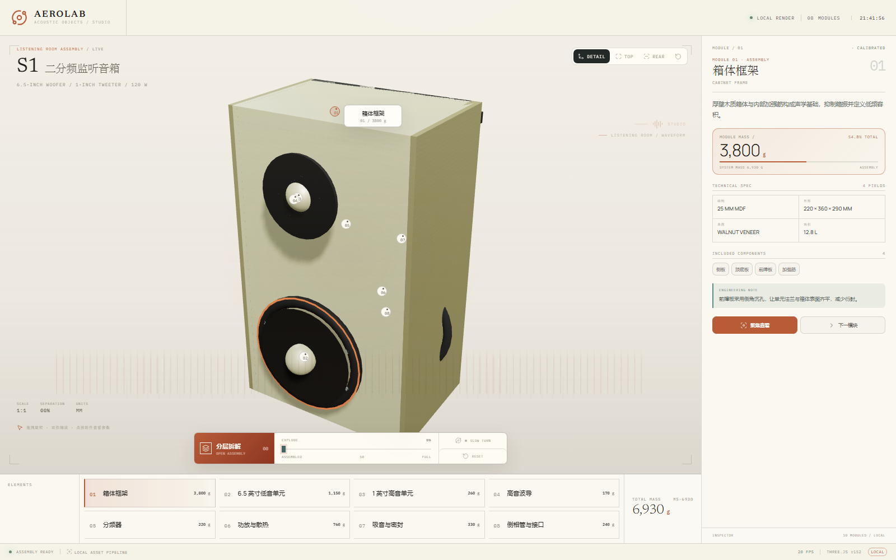

# Exploded View Studio

> 中文简介：把一份 JSON 产品描述渲染成可交互的 3D 爆炸图网页；按产品类型生成专属构造顺序、舞台氛围、镜头视角和动作文案，输出完全离线、手机可直接打开的单文件。
>
> Version 1.2.0 · Author: n44897162-eng · Category: design & visualization

Generate polished, offline Three.js exploded-view product pages from a declarative `scene.json` — with product-specific construction grammar, adaptive art direction, and a single-file mobile build.


## What makes it different

Most product viewers are the same page with a different color. This skill changes the **construction grammar** with the object:

| Product | Stage | Explode grammar | Views | Layout |
|---|---|---|---|---|
| camera | aperture | optical | MACRO / TOP / FRONT | focus |
| quadrotor | rotor | radial | FLIGHT / TOP / NOSE | panorama |
| studio monitor | waveform | layered | DETAIL / TOP / REAR | atlas |
| watch | turntable | circular | DETAIL / TOP / SIDE | focus |
| robot | cell | kinematic | HERO / TOP / DETAIL | workbench |
| medical | scan | scan | SCAN / TOP / DETAIL | panorama |

- **Stage skins** are generative CSS layers: aperture blades, rotor discs, waveform fields, turntable ticks, work cells, scan planes, construction grids.
- **Choreography** staggers modules by construction order; a total stagger window is capped at 0.58 s.
- **Exploded-path connectors** draw one accent line per module from its assembled origin to its current position.
- **Product views** are data, not hardcoded UI.
- **Atlas layout** turns the module rail into a bottom filmstrip for frontal objects such as speakers: up to 8 modules fill a 4×2 grid; 9–12 scroll horizontally instead of shrinking titles.
- **Eight themes** (`aerolab`, `foundry`, `atelier`, `pulse`, `terrain`, `studio`, `nocturne`, `signal`) with independent layout, density, corners, backdrop, typography, chrome, pattern, and motif.
- **Offline by construction**: local Three.js, local subsetted fonts, inline Lucide icons, no CDN, server, or network request.




## Quick start

Requires Node 20+.

```powershell
cd exploded-view-studio
node scripts/validate-spec.mjs examples/camera/scene.json
node scripts/check-assembly.mjs examples/camera/scene.json
node scripts/scaffold.mjs examples/camera/scene.json <output-dir>\my-camera-view
node scripts/audit.mjs <output-dir>\my-camera-view
```

The scaffold creates:

```text
index.html        modular development page
standalone.html   single offline HTML — send this to a phone
scene.json        source spec
check-assembly.mjs
README.md
fonts/  LICENSES/  vendor/
```

Open `standalone.html` directly from the filesystem. It has CSS, fonts, Three.js, the spec, the engine, and license notices embedded.

## Scene spec

A minimal spec has `meta`, `product`, `camera`, `modules`, plus `research` and `assembly` gates. Optional:

- `design` — theme and art-direction overrides.
- `identity` — construction grammar (archetype, stage, views, stagger, connectors, action copy).

```json
"identity": {
  "archetype": "audio",
  "stage": "waveform",
  "construction": "layered",
  "views": [
    { "label": "DETAIL", "theta": 0.38, "phi": 1.25, "zoom": 0.94 },
    { "label": "TOP", "theta": 0.02, "phi": 0.2, "zoom": 0.96 },
    { "label": "REAR", "theta": 2.6, "phi": 1.3, "zoom": 0.92 }
  ],
  "motion": { "stagger": 0.05, "order": "layered", "connectors": true },
  "actions": { "explode": "分层拆解", "assemble": "合拢箱体" }
}
```

Full contract: [`references/spec-schema.md`](references/spec-schema.md).

## Quality gates

1. **Research**: record public or similar-product references; never copy trademarks or proprietary CAD. URLs are provenance only and are not fetched at runtime.
2. **Collision check**: 4 mm OBB/SAT gate. `assembly.internal` is reported, never auto-passed; structural interfaces go in `assembly.mates`; the review must be passed only after visual inspection at 0/50/100%.
3. **Audit**: local assets only, single-file offline build, fonts/icons, dynamic floor, mobile DPR/pins/pinch/zoom, theme/stage/connector hooks.
4. **Visual QA**: 390×844, 1366×768, 1600×1000; no overflow, no console errors, no external requests.

## Documentation

- [`SKILL.md`](SKILL.md) — working summary and workflow.
- [`references/design-rationale.md`](references/design-rationale.md) — GitHub research, fusion decisions, rejected options.
- [`references/spec-schema.md`](references/spec-schema.md) — full spec contract.
- [`references/research.md`](references/research.md) — public-source workflow.
- [`references/self-review.md`](references/self-review.md) — collision and interface review.
- [`references/qa-checklist.md`](references/qa-checklist.md) — browser, mobile, theme, stage QA.
- [`references/archetypes.md`](references/archetypes.md) — composition patterns.

## Examples

- `examples/camera/` — AEROLAB V1 full-frame mirrorless; atelier / aperture / focus.
- `examples/x450/` — X450 quadrotor; signal / rotor / panorama.
- `examples/audio/` — AEROLAB S1 studio monitor; studio / waveform / atlas.

## Performance

- DPR caps 2.5 compact / 1.75 desktop; 1024² shadow; no postprocessing.
- Stage skins are CSS-only; connectors add one draw call.
- Rendering pauses when the tab is hidden.
- Reference camera: ~91 draw calls / ~13k triangles; X450 ~83 / ~14k; audio similar.

## License

Project code is [MIT](LICENSE). Bundled fonts and icons retain their original licenses in `assets/template/LICENSES/`.