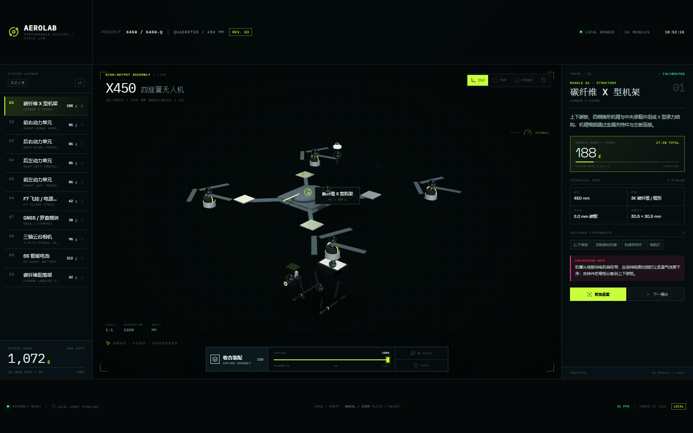
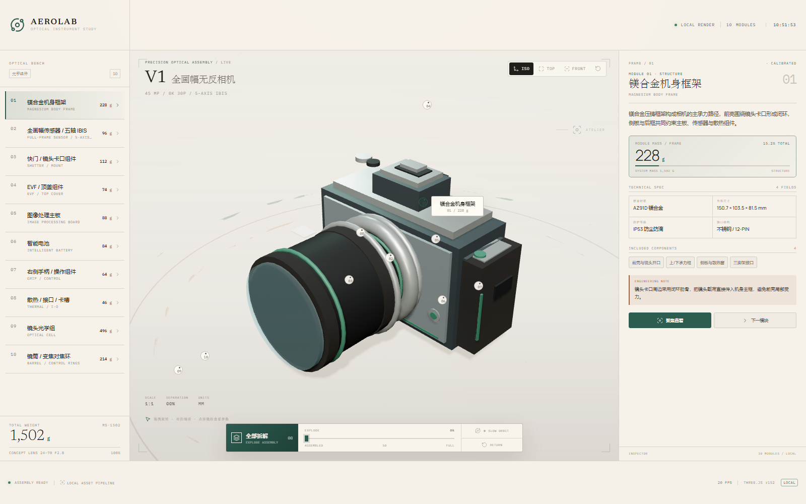
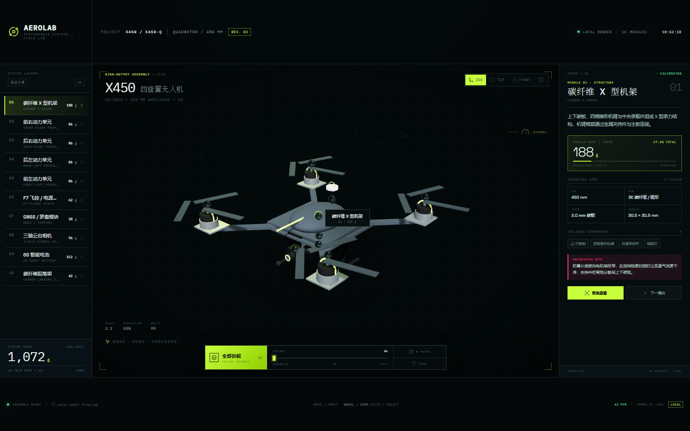

# Exploded View Studio

Turn a declarative scene description into a polished, fully offline Three.js **exploded-view product page** — selectable modules, 3D callout pins, an inspector, an explode slider, orbit/zoom, and a single-file mobile build.

No framework. No build step. No CDN, remote fonts, remote textures, or downloaded 3D models. The output is two HTML files that work straight from `file://`.



---

## What it does

You describe a product as JSON: modules, their parts, masses, specs, and where each module flies when exploded. The toolkit validates that description, checks that the modules do not physically collide, and renders a design-studio-quality page around a procedural Three.js model.

- **Procedural geometry** — models are built from primitives (`box`, `cylinder`, `cone`, `sphere`, `torus`, `ring`, `plane`, `tube`) and a fixed material set (`body`, `silver`, `steel`, `copper`, `pcb`, `chip`, `glass`, `sensor`, `rubber`, `accent`, …). Nothing is downloaded, nothing is licensed from a CAD file.
- **Data-driven art direction** — eight presets (`aerolab`, `foundry`, `atelier`, `pulse`, `terrain`, `studio`, `nocturne`, `signal`) control palette, layout, density, corners, backdrop, typography, and motif. A preset can be inferred from the product name.
- **Honest engineering review** — an OBB collision checker reports cross-module interpenetration at the assembled state, so the exploded view does not hide impossible geometry.
- **Mobile-first output** — responsive breakpoints, DPR caps, touch orbit/pinch zoom, and a `standalone.html` with CSS, base64 fonts, Three.js, and licenses all inlined.

## Quick start

Requires **Node 20+**. No dependencies to install.

```bash
git clone https://github.com/n44897162-eng/exploded-view-studio.git
cd exploded-view-studio

# 1. validate the scene description
node scripts/validate-spec.mjs examples/camera/scene.json

# 2. check that no modules physically collide when assembled
node scripts/check-assembly.mjs examples/camera/scene.json

# 3. render a project folder (index.html + standalone.html)
node scripts/scaffold.mjs examples/camera/scene.json ../my-camera-view

# 4. audit the generated folder (offline, local assets, review gate)
node scripts/audit.mjs ../my-camera-view
```

Open `../my-camera-view/index.html` in a browser. Open `standalone.html` on a phone — it is a single self-contained file.

Expected output:

```text
OK    scene.json  |  10 modules  |  78 parts  |  1502 g
PASS  assembly    |  0 unapproved | review passed
PASS  my-camera-view | local fonts/icons | offline standalone | no remote URLs
```

`scaffold.mjs` refuses to write into a non-empty folder, refuses a spec with unresolved collisions, and refuses a pending assembly review. That is intentional: it will not emit a page it cannot stand behind.

## The scene spec

A scene is a small, readable JSON document. Full contract in [`references/spec-schema.md`](references/spec-schema.md).

```json
{
  "meta":    { "brand": "AEROLAB", "project": "V2", "category": "CONCEPT PRODUCT" },
  "product": { "name": "V2", "tagline": "MIRRORLESS / 980 g", "totalMass": 980 },
  "camera":  { "theta": 0.78, "phi": 1.04, "target": [0, 0.08, 0.28], "fitPadding": 1.12 },
  "design":  { "preset": "atelier" },
  "modules": [{
    "id": "01",
    "title": "机身框架",
    "en": "BODY FRAME",
    "mass": 228,
    "base": [0, 0, 0],
    "offset": [-1.55, 0.1, -0.52],
    "anchor": [0, 0.42, -0.18],
    "description": "Magnesium-alloy chassis that carries the sensor and lens mount.",
    "specs": [["材质", "AZ91D"], ["尺寸", "150.7 × 103.5 mm"]],
    "components": ["前壳", "卡口环"],
    "insight": "Thin walls trade drop resistance for 90 g of mass.",
    "parts": [
      { "type": "box",  "size": [1.5, 0.8, 0.56], "mat": "silver" },
      { "type": "ring", "outer": 0.47, "inner": 0.36, "pos": [0, 0, 0.3], "mat": "accent" }
    ]
  }]
}
```

- `base` is the module origin, `offset` its displacement at 100 % explode, `anchor` the 3D pin location in module space.
- Module masses must sum to `totalMass` within 0.5 g — the validator enforces this.
- `design` is optional; omit it and the preset is inferred from the product name.

### Assembly review

```json
"assembly": {
  "tolerance": 0.004,
  "internal": ["02", "05"],
  "mates": [
    { "modules": ["01", "03"], "reason": "lens mount seated through the front shell" }
  ],
  "review": { "status": "passed", "reviewedAt": "2026-11-11", "notes": "0/50/100% inspected" }
}
```

`internal` is only for modules genuinely hidden inside a shell. `mates` is only for real surface-contact joins. Both are a place to record a decision, not a way to silence the checker — overlaps are still reported.

## Art direction

| Preset | Character | Layout | Type | Backdrop |
|---|---|---|---|---|
| `aerolab` | dark aerospace, orange/cyan | workbench | industrial | rings |
| `foundry` | warm light industrial | workbench | industrial | grid |
| `atelier` | light editorial optical | focus | editorial | horizon |
| `pulse` | clinical white/teal | panorama | humanist | horizon |
| `terrain` | light field/expedition | panorama | humanist | grid |
| `studio` | light audio/furniture | focus | editorial | plain |
| `nocturne` | dark warm luxury | focus | editorial | plain |
| `signal` | dark performance, lime/pink | panorama | technical | grid |

Inference order: camera/optic → `atelier`; medical/wearable → `pulse`; outdoor/field → `terrain`; audio/furniture → `studio`; watch/luxury → `nocturne`; drone/sport → `signal`; tool/robot → `foundry`; otherwise `aerolab`.

Any theme token can be overridden, including a custom `accent` / `alt` hex pair:

```json
"design": { "preset": "foundry", "layout": "workbench", "density": "compact", "colors": { "accent": "#b06a2c", "alt": "#2d6d68" } }
```

## Repository layout

```text
exploded-view-studio/
├── SKILL.md                  # the working summary: rules, gates, workflow
├── assets/
│   ├── template/             # index.html, styles.css, design.js, engine.js, fonts
│   └── vendor/               # Three.js r152.2 UMD + license
├── examples/
│   ├── camera/               # full-frame camera scene + previews
│   └── x450/                 # quadrotor scene + previews
├── references/
│   ├── spec-schema.md        # complete JSON contract
│   ├── research.md           # sourcing product facts honestly
│   ├── self-review.md        # collision / interface review at 0/50/100 %
│   ├── archetypes.md         # composition patterns per product class
│   ├── qa-checklist.md       # browser, theme, mobile, floor tests
│   └── environment.md        # paths, browser setup, performance budget
└── scripts/
    ├── validate-spec.mjs     # schema + design + research validation
    ├── check-assembly.mjs    # OBB collision report
    ├── scaffold.mjs          # render index.html + standalone.html
    ├── bundle.mjs            # single-file inliner
    └── audit.mjs             # offline / local-asset / review gate
```

## Examples

| Full-frame camera (`atelier`) | Quadrotor (`signal`) |
|---|---|
|  |  |

Both examples are complete scenes with research notes, a passed assembly review, and generated previews.

## Using it as an agent skill

The folder is a self-describing skill: `SKILL.md` carries the frontmatter (`name`, `description`, `whenToUse`) and the operating rules. To install it for an agent, copy or symlink this directory into that agent's skills directory, keeping the folder name identical to the frontmatter `name`:

```text
<skills-dir>/exploded-view-studio/SKILL.md
```

## Guarantees and limits

- **Offline by construction.** `audit.mjs` rejects remote URLs anywhere in the output. Research URLs in a scene are provenance only and are never fetched.
- **Values are conceptual.** Masses, dimensions, and specs are approximations for presentation, not CAD measurements. The README that the scaffold writes says so; keep that statement when you adapt a page.
- **Original geometry.** References inform proportions and module hierarchy. Trademarks, trade dress, textures, and proprietary CAD are not copied.
- **The collision checker is an OBB aid, not a CAD kernel.** It is conservative in both directions; your eyes are still the final check at 0 %, 50 %, and 100 % explode.

## 中文说明

**这是什么**：一个把 JSON 场景描述变成「离线、可交互的 3D 产品爆炸图网页」的工具包。含 8 套视觉预设、模块选择与 3D 引脚、装配碰撞检查、移动端单文件构建。输出不依赖任何 CDN 或远程资源，双击 HTML 即可打开。

**怎么用**：装 Node 20+ 后，依次跑 `validate-spec.mjs` → `check-assembly.mjs` → `scaffold.mjs` → `audit.mjs` 四条命令即可（见上方 Quick start）。仓库里 `examples/camera` 与 `examples/x450` 是两份完整示例，改它们的 `scene.json` 就能做出自己的产品页。

**注意**：模型由基础几何体程序化拼装，质量、尺寸为演示用估算值，不是 CAD 数据。

## License

[MIT](LICENSE). Bundled third-party assets keep their own licenses — see [`assets/template/LICENSES/ASSETS.md`](assets/template/LICENSES/ASSETS.md) and [`assets/vendor/THREE-LICENSE.txt`](assets/vendor/THREE-LICENSE.txt).
